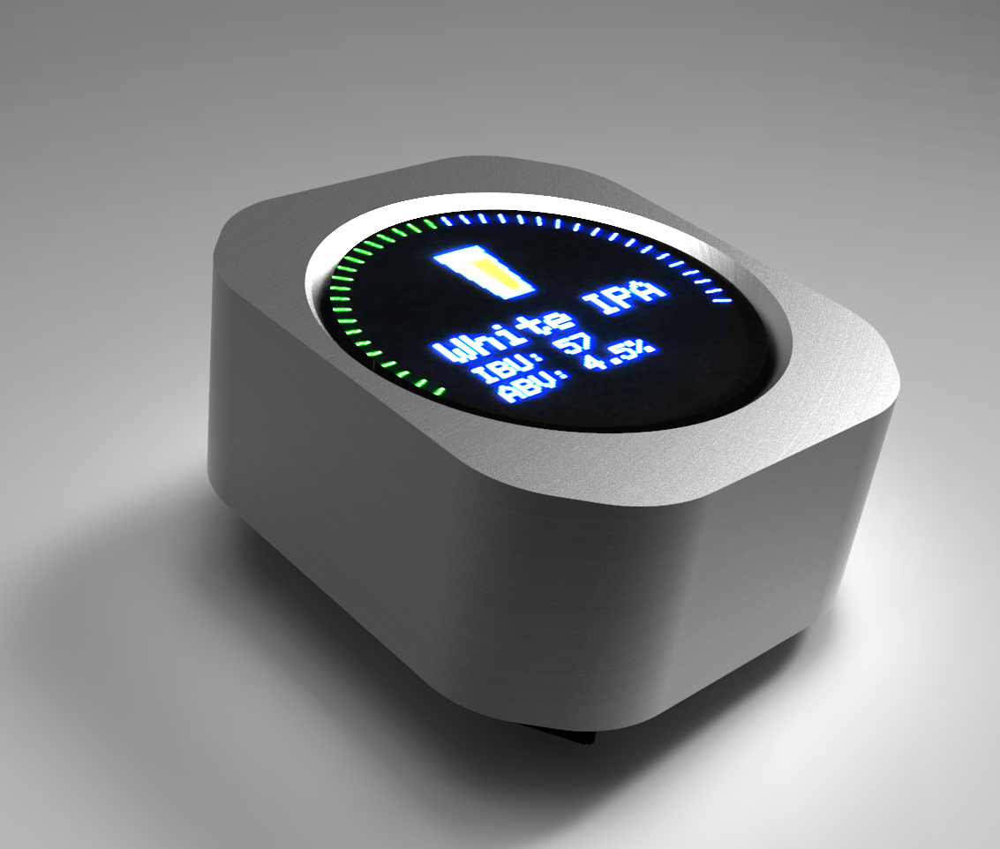

# BeerTapRoundDisplay V2 - Remote Scale (ESP32-C6 + BLE)

## Attention: Fully functionnal but a tap on the display screen will tare the keg weight. This should be changed to double tap or ask for confimation.

Fork of [BeerTapRoundDisplay](https://github.com/smillier/BeerTapRoundDisplay) that separates the scale (HX711 + weight sensors) from the round GC9A01 display. The two boards communicate over Bluetooth Low Energy instead of being wired together on a single ESP32.
─────────────────────────┐        BLE (GATT)        ┌──────────────────────────┐
│   scale-esp32c6          │  ────────────────────►   │   display-esp32          │
│   ESP32-C6 + HX711       │   notify weight (g)       │   ESP32-C3 + round touch │
│   under the keg           │  ◄────────────────────   │   Wifi + WebServer + OTA │
│                          │   tare command             │   computes volume        │
└─────────────────────────┘                            └──────────────────────────┘

`display-esp32` now targets an all-in-one **ESP32-C3 + 1.28" round GC9A01 touch display** module (sold on AliExpress under the PCB reference "JCZN ESP32-2424S012"), instead of a bare ESP32 wired to a separate GC9A01 breakout. Tapping the screen sends a tare command, same as the "Tare" button in the web UI.

## Why two boards?

- The scale (HX711 + load cells) stays as close as possible to the keg, under its foot, far from the display, which is mounted remotely on the cabinet/fridge front panel.
- The ESP32-C6 is a natural fit for this node: small, cheap, native BLE, no need for Wifi/display/large flash on the scale side.
- The display keeps the existing Wifi/OTA/web server (beer config, IBU, ABV, SG...) and shows a status dot (green/orange/red) indicating how fresh the BLE link is.

## Repo structure
scale-esp32c6/     Scale firmware (HX711 -> BLE GATT server)
display-esp32/     Display firmware (BLE GATT client -> display + Wifi/webserver)
These are two independent PlatformIO projects, flashed separately (two `platformio.ini` files).

## BLE Protocol

The scale (`scale-esp32c6`) is the **BLE server (peripheral)**; the display (`display-esp32`) is the **BLE client (central)**. There's no pairing/bonding (no sensitive data is exchanged) — the connection is made by filtering on the service UUID.

| Element | UUID | Type | Content |
|---|---|---|---|
| Scale service | `a1f4e100-3b7a-4f56-9d1b-2f6a9c5e10a0` | - | - |
| Weight characteristic | `a1f4e101-3b7a-4f56-9d1b-2f6a9c5e11a0` | READ + NOTIFY | `float32` weight in grams |
| Command characteristic | `a1f4e102-3b7a-4f56-9d1b-2f6a9c5e12a0` | WRITE | `uint8`: `0x01` = tare |

These values are defined in `scale-esp32c6/include/config.h` and `display-esp32/include/config.h` (must stay identical on both sides).

Behavior:

- The scale measures weight every `WEIGHT_UPDATE_PERIOD_MS` (2s by default) and notifies the value if a client is connected.
- The display scans, connects to the first device advertising the service above, and automatically resubscribes on disconnection (`BLE_RECONNECT_PERIOD_MS`).
- Volume (weight / configured SG density on the display) is still computed on the display side, as before — the scale only reports raw weight.
- A "Tare" tap in the display's web UI (`POST /tare`) sends the command to the scale, which performs `scale.tare()`.
- `GET /scale_status` returns `{"connected":bool,"stale":bool}` for external monitoring.
- On the display, a dot at the top of the dial shows status: green = fresh data, orange = connected but stale data (> `BLE_WEIGHT_STALE_MS` = 15s), red = scale not connected.

## scale-esp32c6/ - HX711 wiring

| HX711 | ESP32-C6 |
|---|---|
| DOUT | GPIO2 |
| SCK | GPIO3 |
| VCC | 3.3V (or 5V depending on HX711 module) |
| GND | GND |

GPIO2/3 were chosen because GPIO4, 5, 8, 9, 15 are boot strapping pins on the ESP32-C6 and must be avoided. Adjust `SCALE_CALIBRATION_FACTOR` in `scale-esp32c6/include/config.h` for your own load cell (same calibration procedure as the original: weigh a known weight and adjust the factor).

`scale_setup()`/`scale_tare()`/`getWeight()` use `HX711::wait_ready_timeout()` (1s) instead of the library's plain `tare()`/`get_units()`, which otherwise block forever if the HX711 never pulls DOUT low (not wired yet, loose connection...). Without this guard, a disconnected load cell hangs `setup()` before BLE ever starts advertising - with it, the scale still comes up and reports `0.0`.

### Building scale-esp32c6 on Windows

This project uses the [pioarduino](https://github.com/pioarduino/platform-espressif32) platform fork (the official PlatformIO `espressif32` registry entry dropped Arduino framework support for ESP32-C6). Two Windows-specific gotchas:
- **Build from a native shell (cmd/PowerShell), not Git Bash/MSYS** - pioarduino's `idf_tools.py`/esptool install step explicitly refuses to run under MSYS ("MSys/Mingw is not supported").
- **Set the console to UTF-8 first** (`chcp 65001` in `cmd`/PowerShell, plus `$env:PYTHONIOENCODING="utf-8"`) - esptool's progress bar otherwise crashes PlatformIO's output relay under the default `cp1252` codepage.

## display-esp32/ - Display

Runs on an **ESP32-C3** all-in-one module with a built-in 1.28" round GC9A01 display and CST816 capacitive touch, everything on one small board/PCB (no separate breakout or wiring). Pins (see `display-esp32/include/config.h`):

| Function | Pin |
|---|---|
| TFT MOSI | GPIO7 |
| TFT SCLK | GPIO6 |
| TFT CS | GPIO10 |
| TFT DC | GPIO2 |
| TFT RST | not connected (module is reset over SPI) |
| TFT Backlight | GPIO3 |
| Touch SDA | GPIO4 |
| Touch SCL | GPIO5 |
| Touch RST | GPIO1 |
| Touch INT | GPIO0 |

The touch controller (CST816, I2C address `0x15`) is handled by `display-esp32/src/touch.cpp` using the [fbiego/CST816S](https://github.com/fbiego/CST816S) library: a single tap anywhere on the screen sends a tare command to the scale over BLE.

The HX711 is no longer wired on this board (moved to `scale-esp32c6`).

## Flashing both boards

Each folder is a standalone PlatformIO project:
cd scale-esp32c6
pio run -t upload         # ESP32-C6 over USB
cd ../display-esp32
pio run -e esp32-c3-usb -t upload     # ESP32-C3 firmware, first flash over USB
pio run -e esp32-c3-usb -t uploadfs   # ESP32-C3 filesystem image (data/ folder - web UI, beer BMPs)
pio run -e esp32-c3-ota -t upload     # subsequent firmware flashes over Wifi/OTA (set upload_port in platformio.ini to the display's IP/hostname)
`display-esp32` keeps OTA (ArduinoOTA + ElegantOTA) as in the original project; `scale-esp32c6` is flashed over USB (no OTA, no Wifi on this board).

**The filesystem image (`uploadfs`) is required, not optional** - without it SPIFFS fails to mount, `initialize()` returns before ever calling `display_init()`, and the screen stays blank.

### Native-USB boards (JCZN ESP32-2424S012, ESP32-C6-DevKitM-1, clones): manual reset needed

Both boards talk USB through the chip's built-in USB-Serial/JTAG controller (no external CP210x/CH340 bridge), which has no reliable auto-reset circuit:
- **Entering bootloader mode** (before every `upload`/`uploadfs`): hold **BOOT**, tap **RESET** while still holding BOOT, then release BOOT.
- **Returning to normal run mode** (after every flash): a plain RESET tap is not reliable either - fully **unplug/replug the USB cable** to guarantee a clean boot into the app.
- **Opening a serial monitor can itself reset the board back into bootloader** (default DTR/RTS assertion on connect is misread as a reset request). If the monitor shows nothing at all right after a flash, reopen it with `pio device monitor -p COMx -b 115200 --rts 0 --dtr 0` before assuming the firmware is broken.

Hardware-verified on real boards (2026-07): `display-esp32` boots, connects to Wifi (falls back to the `TapDisplay_AP` WiFiManager captive portal if no credentials are saved), shows the beer dial, and tap-to-tare over touch. `scale-esp32c6` advertises over BLE, the display connects (status dot green), and the tare command round-trips correctly (`Tare requested by display` logged on the scale on each tap) - tested without load cells physically wired.

## Limitations / TODO

- The `Case/` and `PCB/` files from the original repo (3D enclosure, Eagle PCB) were designed for the combined display+HX711 board: they'll need to be redesigned/split into two enclosures (not addressed in this version, out of software scope).
- `data/config.json` (demo content from the original repo) contains a dummy SSID and Wifi key in plain text — check/clean this up before publishing if that wasn't intentional.
- No BLE pairing (LE Secure Connections): fine for home use where only weight is transmitted, but worth keeping in mind if the protocol evolves.
